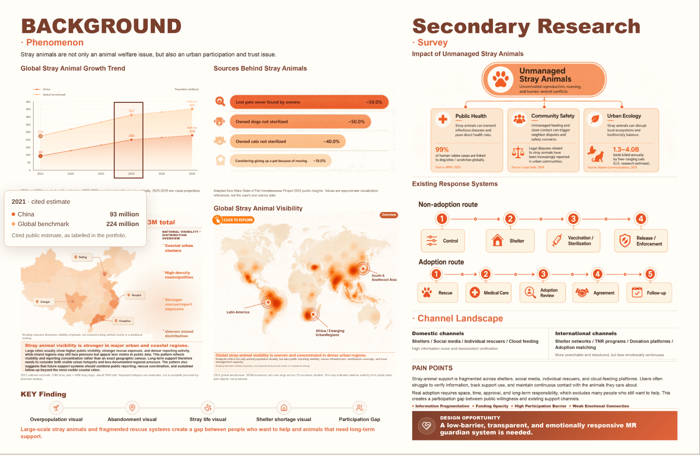
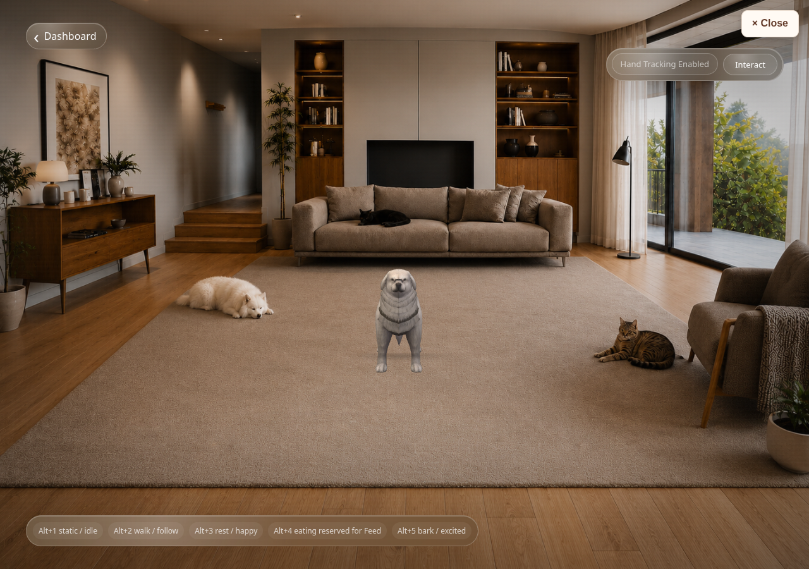
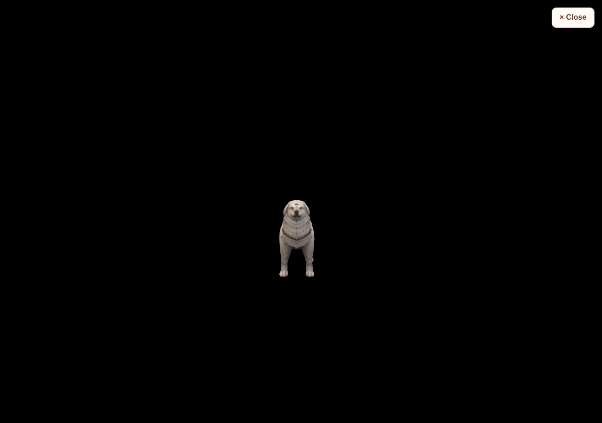

# 折线图连续悬停与原型退出修复

## 原因与修复

折线图原实现只依赖透明年份按钮的 pointerenter，没有绘图区 pointermove 坐标选择；dismiss 还受元素焦点限制，提示框也可以接收鼠标。现在由绘图区持续接收鼠标移动，通过 SVG getScreenCTM 的逆矩阵转换到 1300 × 760 viewBox，选择横坐标最近的年份。鼠标、键盘、触屏共用当前年份，但键盘/触屏选择不锁定后续鼠标移动；鼠标离开绘图区立即清除鼠标状态。SVG 装饰和提示框均 pointer-events:none。原始数据计算、性质标注、配色与布局没有改变。

原入口是带 target=_blank / noreferrer 的外部链接，不是覆盖层或 iframe；作品集无法监听外部标签页内的 Escape，也不持有其摄像头/识别任务。为了让实验分支可以独立预览和验证完整修复，入口现在改为仓库内 `./mr-prototype/index.html`，仍打开新标签页。

原型来自 `laiyinheng-spec/guardian-space-prototype` 提交 `d5dc49748c3b310c6221f642d6b43d9d773e84b6`，以原有独立 HTML/CSS/JavaScript 结构随作品集提供。**原外部 Vercel 网址没有修改、部署或同步这次修复；直接打开旧网址仍是原线上版本。**

## 新增及修改文件

- 修改 `src/components/charts/BackgroundTrendChart.tsx`、`background-trend.css`：绘图区连续命中、输入状态和提示层事件处理。
- 修改 `src/pages/PortfolioImagePage.tsx`：保留原入口按钮位置和样式，改为同源独立原型地址，绑定导航与返回处理。
- 新增 `src/hooks/usePrototypeNavigation.ts`：保存入口滚动位置、校验同源退出消息，恢复按钮焦点；同标签页回退方式也有明确地址。
- 新增 `public/mr-prototype/`，共 71 文件，约 124MB：
  - 原有入口和原型源码：`index.html`、`styles.css`、`script.js`、`gesture-room.html`、`gesture-room.css`、`gesture-room.js`。
  - 新增退出设施：`prototype-exit.js`、`prototype-exit.css`。
  - 来源记录：`UPSTREAM.md`。
  - 原型原有 62 个素材，全部逐文件 SHA-256 比对一致，包含房间、动物、FBX/GLB、贴图、参考图等。保留原参考查看功能所需素材，没有重新生成或替换素材。
- 本验证目录：检查结果、截图与 [新增原型文件完整清单](new-prototype-files.txt)。

未增加作品集依赖，未修改其他页面、图表数据、手势阈值、狗狗行为规则或状态流程。仅为右上 Close 给原有手势工具栏留出必要空间，避免盖住 Interact。

## 退出及生命周期

两个实际原型 HTML 都先加载独立退出设施，不依赖 Three.js、模型、WASM 或摄像头初始化成功。右上真实按钮“× Close”和文档捕获阶段 Escape 调用同一退出流程。

退出先取消渲染及手势识别 requestAnimationFrame、清理计时器和监听、停止所有摄像头 tracks、清空视频 srcObject、关闭识别器、停止动画混合器并释放场景/渲染器资源，再通知原作品集标签页恢复滚动和焦点。脚本打开的标签页会关闭；不能关闭或独立访问时会导航至明确的同源作品集 `#mr-prototype-entry` 地址，不依赖浏览历史。

异步 getUserMedia、识别器、Three.js 和模型/贴图加载都有退出检查；退出后才返回的流立即停止、识别器立即关闭，不会重新启动后台循环。手势原型内部跳转/浏览器 pagehide 同样执行资源清理。

原型没有 iframe。Escape 在拥有画布与摄像头的实际文档内处理。按钮使用非模态顶层 popover，浏览器元素全屏时也保持在画布之上；全屏退出事件进入相同退出流程。

## 已完成验证

- `npm run build`：TypeScript / Vite 构建通过；三个原型 JavaScript 文件 `node --check` 通过。
- 连续鼠标移动：2021 → 2026 → 2021，全程不离开绘图区；年份、两组数值、数据性质和竖向参考线正确。覆盖 1440、1024、390、320px，以及 CSS zoom 80%、125%、150%。
- 键盘方向键及触屏选年保留；随后普通鼠标移动可立即覆盖键盘或触屏选择。离开绘图区清除鼠标状态；提示框不拦截事件。
- Chromium 真实新标签页 Close、画布聚焦后 Escape、主脚本加载被延迟时退出、独立 URL 返回均通过；恢复入口焦点与原滚动位置。
- 浏览器元素全屏实测：画布全屏后 Close 仍可见；退出全屏事件触发统一退出流程。原型自身没有自动全屏调用。
- 实际 3D 房间、全部五个狗狗 FBX 模型、纹理成功加载，原键盘动作切换有效。
- 生命周期测试使用浏览器模拟摄像头（真实 MediaStream）和可控识别器替身：退出前摄像头 track 为 live、两个动画/识别循环；清理后 track 为 ended、待执行 requestAnimationFrame 为 0、video.srcObject 为 null、识别器 close 已调用。
- 在同一仍存活文档中延迟返回摄像头流、延迟返回识别器，再执行清理：晚到流停止、晚到识别器关闭，没有重启动循环。这不依赖关标签页时浏览器自动释放资源。
- 模拟摄像头权限拒绝后 Escape 仍可退出；再次打开新原型文档，可以重新启动浏览器模拟摄像头与可控识别器。

检查原始记录：

- [图表不同宽度与缩放](chart-results.json)
- [触屏、数值及数据性质](chart-touch-results.json)
- [Close / Escape / 加载中 / 全屏 / 返回](exit-results.json)
- [资源生命周期及晚到资源](resource-results.json)

## 限制与未执行检查

真实 MediaPipe 模块已成功导入，但其原有 `storage.googleapis.com` 模型下载地址在当前环境返回 403，完整真实模型识别未能验证。没有更换模型地址或手势算法。生命周期测试的识别器是测试期间的网络替身，仅在检查脚本中使用，生产源码未加入替身。

未实测真实摄像头、真人手势、用户电脑浏览器、真实移动设备、Safari、Firefox 或操作系统 F11 全屏；全屏检查针对 Chromium 的元素 Fullscreen API。截图中的 “Hand Tracking Enabled” 来自上述可控识别器生命周期场景，不代表真实模型识别测试通过。

## 截图



原有房间、狗狗及新增 Close（浏览器模拟摄像头 / 可控识别器场景）：



浏览器画布元素全屏时，Close 仍位于顶层：



## 用户电脑预览

保存本地修改后同步实验分支并启动：

```sh
git switch guardian-space-interaction-upgrade
git pull --ff-only origin guardian-space-interaction-upgrade
npm install
npm run dev
```

打开自己终端显示的作品集地址，末尾入口会打开当前仓库的同源原型子路径。也可直接访问该地址下 `/mr-prototype/index.html` 或 `/mr-prototype/gesture-room.html`；独立访问的 Close 会返回同源作品集入口。不要用原外部 Vercel 地址判断这次未部署的实验分支修复。
