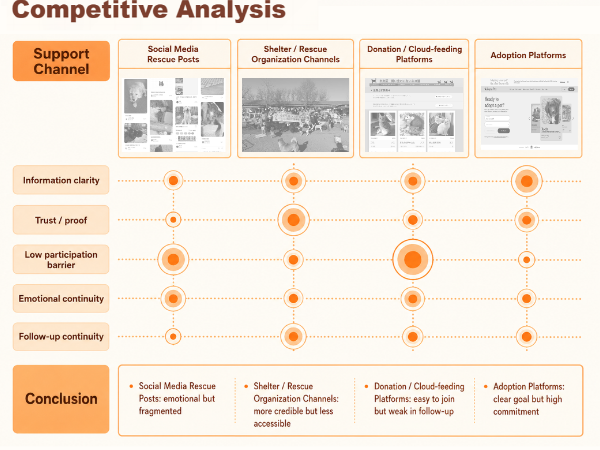
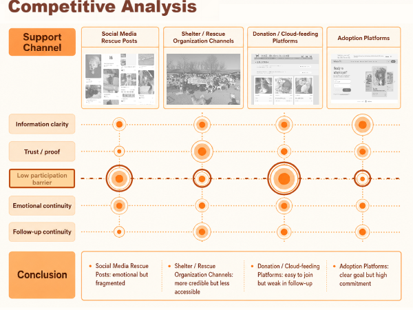
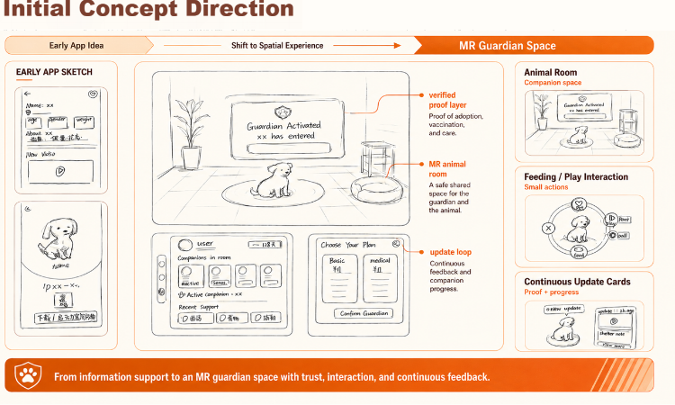
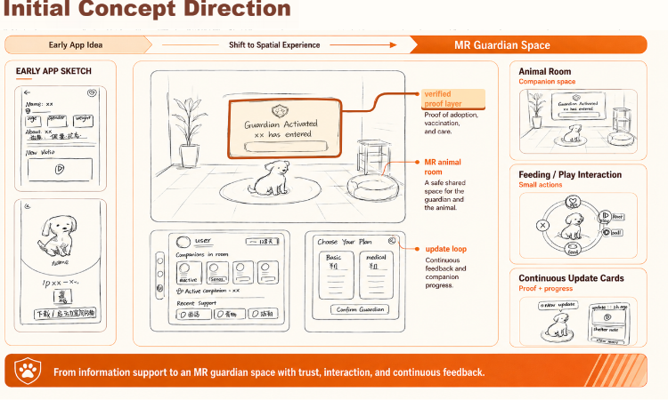
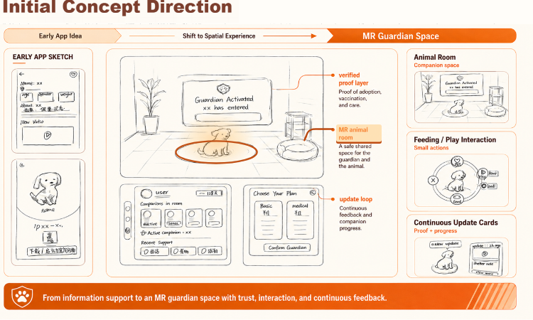
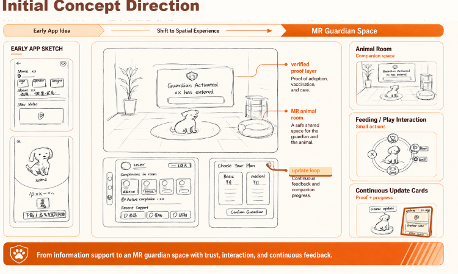
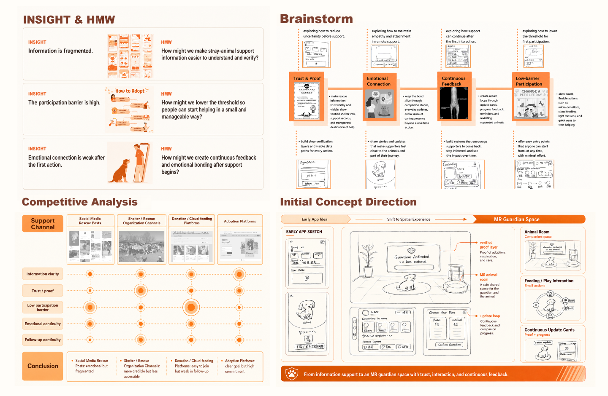
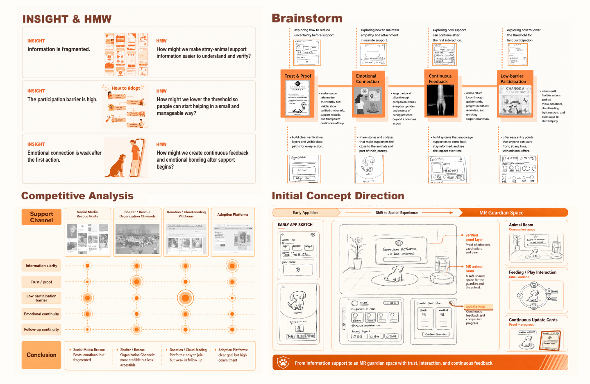

# 概念页悬停交互：浏览器核对与前后截图

截图来自 Chromium 中真实鼠标悬停，页面视口宽度 1440px。下面的局部截图均按同一坐标裁切，保留实际像素尺寸，没有放大。

## 原提交 eed8361 的核对

- 当前入口为 `App → PortfolioImagePage`，概念页图片是 `/assets/page04/page04-concept.png`，匹配 `pageNumber === '04'`。含封面时为第 04 张，确为 Competitive Analysis / Initial Concept Direction 所在页。
- 原版组件已挂载。对五个行标题、三个橙色标注逐一移动鼠标，8 个入口的 `elementFromPoint` 均命中按钮，`data-active` 均变为 `true`，CSS 已加载，SVG 最终透明度为 `1`。
- 在此环境未复现“完全不响应”。原样式描边偏细、与底图橙色接近，可见性不足。本次不将用户反馈归因于拉取或缓存。

## 本次处理

- 明确隔离图层：图片 z-index 0、交互层 1，层内绘图 1、触发区 2。图片与绘图不拦截触发区事件。
- 保留 pointer 事件，并增加桌面 mouse 事件兼容；合成触屏鼠标事件不触发悬停。
- 保持 SVG 图层挂载，移除切换时重建 SVG 和透明度关键帧的依赖，改用稳定图层的透明度过渡。
- 提高行标题、横向虚线、圆点外圈、草图标注与目标区域的对比度。未改变原圆点大小、位置和填充。
- 保留 200ms 过渡、键盘焦点、减少动态效果，以及触屏静态阅读。
- 原 `update loop` 引线指向 Choose Your Plan；保留原线和原字，实际联动目标仍为右下 Continuous Update Cards 中的更新记录界面。

## 同一区域：竞品分析

悬停前：

悬停 Low participation barrier 后：

## 同一区域：概念草图

悬停前：

悬停 verified proof layer 后：

悬停 MR animal room 后：

悬停 update loop 后：

## 实际整页截图

## 验证范围

- 构建通过。
- Chromium 1440 / 1024 / 768 / 390 / 320px：五行、三个标注、快速切换、移开恢复、键盘焦点、原页面尺寸、无新增留白与横向溢出。
- 单独验证 mouse-only 事件可激活及恢复；正常鼠标测试使用真实坐标移动。
- 触屏模拟保持静态，减少动态效果设置生效。
- 未在用户的 Windows 浏览器、真实手机或屏幕阅读器中人工复测。
