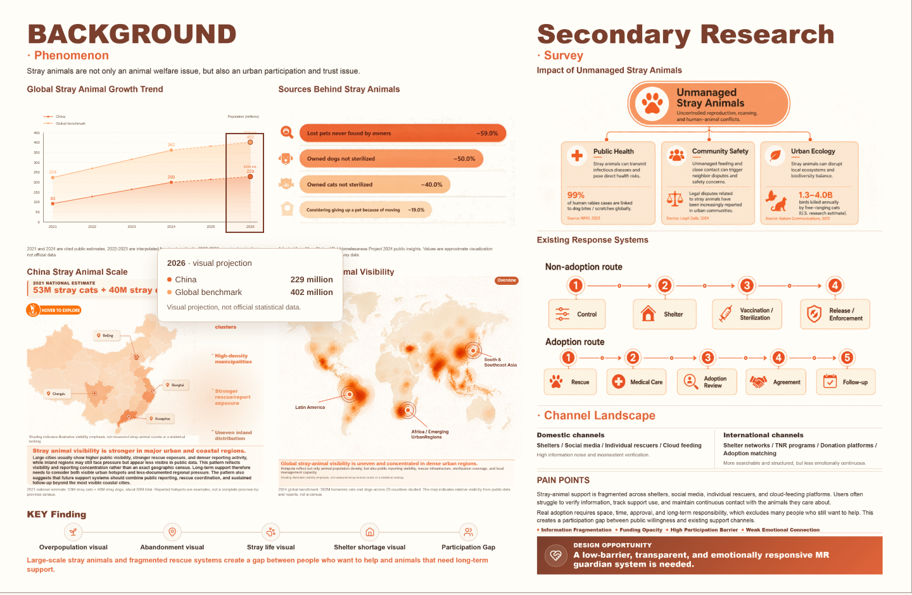

# 连续年份悬停修复；MR 尺寸对照状态

## 本次实际修改

只修改 `src/components/charts/BackgroundTrendChart.tsx`。图表数据、配色、布局、原型入口和原型文件均未修改，Close / Escape 保持上一提交的实现。

旧版更新处理器依赖 React 图表容器的事件冒泡。如果移动事件在现有透明年份目标上被截断，就无法收到之后的横向移动，会一直显示首次年份。现在使用文档捕获阶段的原生 pointermove / mousemove，按实际 SVG 的 getScreenCTM 逆矩阵计算最近年份，不依赖事件目标、年份按钮边界或冒泡。监听随组件卸载移除，鼠标离开绘图区或窗口后清除鼠标状态。

键盘、触屏状态保留，普通鼠标可以覆盖它们；鼠标点击也正确记为鼠标输入，不再被当作触屏固定状态。提示层和 SVG 装饰继续使用 pointer-events:none。

## 复现和验证

在当前实际挂载的 Background 页面使用 Chromium 真实鼠标移动，而不是只调用 React 处理器：

- 默认 Chromium 路径在修复前可以连续更新，未复现用户浏览器中的默认锁定。
- 在实际存在的透明年份按钮上加入受控事件冒泡阻断后，修复前真实移动 2025→2026→2024，提示始终停在 2025；见 [修复前记录](chart-before.json)。这是受控故障复现，不宣称已确定用户本机事件被截断的具体来源。
- 修复后保持相同阻断条件，2025→2026→2024 以及 2021→2026→2021 均可在不离开图表、不点击时连续更新。
- 检查两组数值、单位、数据性质、当前节点对应年份和 SVG 竖向参考线路径；离开绘图区后清除，键盘方向键保持可用。
- 覆盖 1440、1024、390、320px 及 CSS zoom 80%、125%、150%。见 [修复后记录](chart-fixed-results.json)。
- 触屏点按年份可切换，随后普通鼠标能覆盖触屏状态；所有年份数值及性质标签正确。见 [触屏记录](chart-touch-results.json)。
- `npm run build` 与 `git diff --check` 通过。

## MR 尺寸：没有猜测或改写缩放

添加 Close 前作品集按钮指向的旧网址是：

https://guardian-space-prototype.vercel.app/

尝试使用同样 1440×900、100% 缩放、非全屏的 Chromium 访问旧网址，当前环境返回 `ERR_TUNNEL_CONNECTION_FAILED`；curl 也被环境代理拒绝（403）。见 [实际访问记录](external-result.json)。因此无法读取旧线上页面的容器、缩放规则或显示尺寸，也不能认定本地来源提交就是用户实际使用的线上版本。

此前对照原型源码 Git d5dc497 的本地场景和中央面板，三个视口均与当前复制版本一致；此结果只证明本地源码一致，不能替代旧线上版本核对。

按用户最新要求，本次不自行估算或放大 MR，不再次迁移原型，保留 Close / Escape。**MR 尺寸恢复尚未完成；需要核对的旧网址就是上面的原外部网址。**

未实测用户电脑浏览器、真实触屏设备、其他浏览器或物理摄像头；本次未重复摄像头和原型生命周期测试，因为原型代码没有改变。
