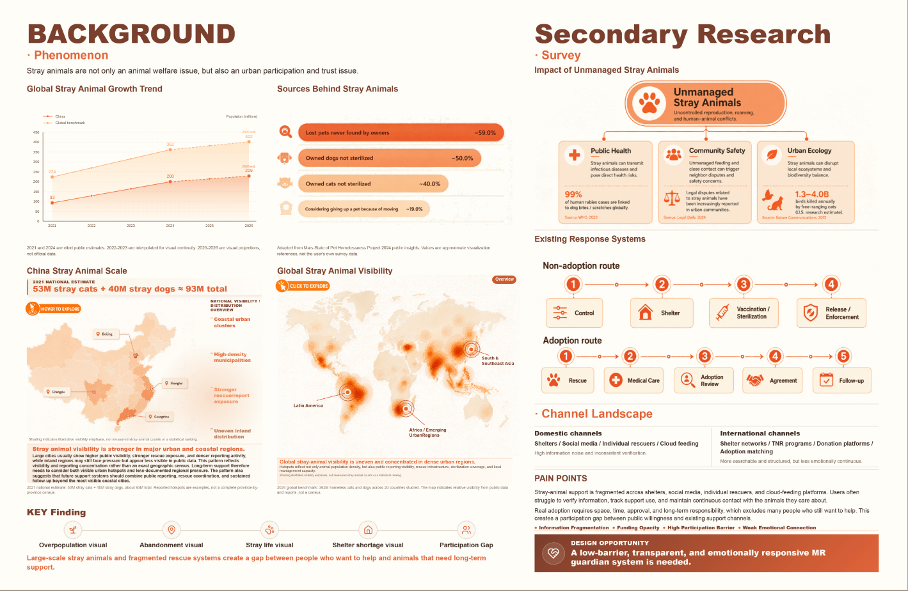
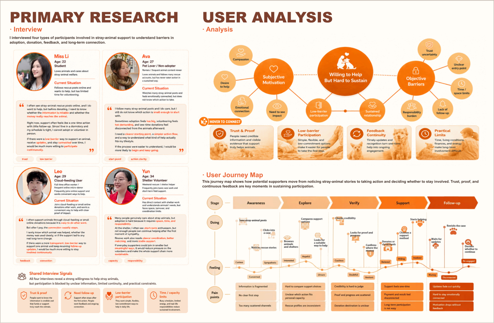
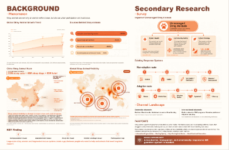
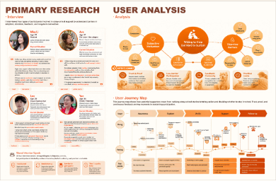

# 三个交互提示角标

仅在实际 Background（第 02 张图片）和 Primary Research / User Analysis（第 03 张图片）的原图片容器中新增三个独立透明 PNG 层。所有原底图、已完成的交互组件和原素材均保留。两张 layout 图片没有进入网页 DOM、CSS 背景或 SVG，仅用于测量位置。

## 定位与透明边距

按参考图 1419 × 924 中的图片画布位置换算到当前 4994 × 3257 整页坐标，使用原透明图片，不裁边、不重绘、不拉伸：

| 图片 | 完整画布左上坐标（原页） | 画布宽度（原页） | PNG 内可见内容边界 |
| --- | --- | --- | --- |
| hover-to-explore.png | 119.66, 1621.45 | 344.90 | 34,66 → 663,237，原图 692×308 |
| click-to-explore.png | 1502.78, 1512.18 | 323.78 | 18,42 → 620,195，原图 638×240 |
| hover-to-connect.png | 1967.33, 1124.44 | 510.31 | 72,61 → 968,311，原图 1026×390 |

完整画布按百分比定位、宽度同比例缩放、高度自动保持 PNG 比例。定位已计入透明空白，因此可见图形与布局参考对应。角标容器和图片均 `pointer-events:none`，没有新按钮、链接、Tab 焦点、事件处理或动画。

中国地图和世界地图原有的重复纯文字操作提示改为仅供辅助技术读取；世界地图 `aria-describedby` 仍有效。没有用色块遮字。研究页没有额外的重复可见文字提示。数据说明、来源、Overview、读图说明和所有既有交互均保留。

## 完成截图

与参考图等宽的 1419px 浏览器截图，完整保留现有动态地图和折线图实现：





390px 窄屏，角标仍随整页缩放，没有增加高度：





## 已执行检查

- `npm run build`：TypeScript / Vite 构建通过；`git diff --check` 通过。
- Chromium 实际浏览器检查 1440、1419、768、390、320px：三个角标均加载指定 PNG，比例与原始透明图片一致、完整画布位于原页容器内；页面高度、下一页起点保持不变，无横向溢出。
- 桌面与窄屏截图核对：位置、尺寸与参考对应，未遮挡标题、正文或图表，没有被容器裁切。
- 上述五种宽度下实际鼠标回归：四个中国城市弹卡、三个世界区域切换、Overview 恢复、折线图年份提示，以及四个研究主题的证据联动均正常；主题移开恢复。
- 390px 模拟触屏回归：中国热点点按弹卡、世界区域点按和 Overview、研究主题点按固定及再点取消均正常。
- 三张提示图片没有按钮/链接/Tab 属性，命中测试不会由角标截获；没有加载任何 layout 图片作为页面内容。
- 仍为八张整页图片，浏览器无 JavaScript 页面错误。
- 没有修改热点坐标、逐行证据或节点位置、其他页面、MR Prototype 或依赖。

记录见 [check-results.json](check-results.json) 和 [touch-results.json](touch-results.json)。

## 未执行

未实测真实手机、用户电脑浏览器、Safari、Firefox 或屏幕阅读器。触屏检查使用 Chromium 设备模拟。窄屏按要求整页同比例缩放，角标没有另设最小显示尺寸。

## 用户电脑同步预览

保存本地修改后，在仓库目录执行：

```sh
git switch guardian-space-interaction-upgrade
git pull --ff-only origin guardian-space-interaction-upgrade
npm install
npm run dev
```

打开自己终端显示的本地地址，查看 Background 和 Primary Research / User Analysis 页。
