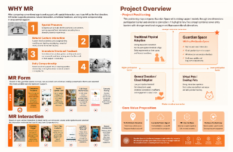

# MR Form / MR Interaction 悬停检查

本次只在实际挂载的第 05 张整页图片上添加相对 4994 × 3257 的 SVG 装饰及八个透明触发区，未替换原图片、文字或勾叉。页面尺寸与后续页面起点保持不变；默认状态与隐藏交互层的截图逐像素一致。

## 同一区域悬停前后（1440px 浏览器视口，原始截图尺寸）

未悬停：


悬停 Companion Presence：图片边框、原勾号外环，以及 real room / co-presence / everyday connection 原句底纹同步出现。


悬停 Complex Multi-step Controls：只强调原图关于 complicated commands / interrupt the relaxed guardian experience 的文字，没有重绘文字或改变叉号。


390px 窄屏下以鼠标模拟悬停检查坐标；实际触屏保持静态阅读：



## 已执行

- `npm run build`：TypeScript 与 Vite 构建通过。
- Chromium 真实鼠标移动：1440、1024、768、390、320px 下，逐一进入八组图片、文字及符号所在的触发区域；活动组唯一，反馈显示，移开恢复，快速跨组切换无状态残留。
- 八组整页及局部截图逐一核对：边框对应原图片，橙环对应原勾叉；底纹逐行对应原文，没有重复文字。
- 五种宽度下键盘焦点检查通过；另实际逐次 Tab 遍历八组并离开，顺序、可见焦点与反馈正确。
- 五种宽度下图片保持原比例，无横向溢出；1440px 下页高为 939.140625px（原比例理论值 939.142972px，浏览器子像素舍入），与后一页间隙为 0；整页图片仍为八张。
- 模拟触屏点按未激活悬停；模拟 `prefers-reduced-motion: reduce` 后过渡为 0s。
- 默认叠加层与隐藏叠加层截图完全一致；没有新增可见控件、空白或说明面板。
- `git diff --check` 通过；未更改前面页面组件、MR Prototype 链接或原素材。

自动检查汇总见 [check-results.json](check-results.json)。

## 检查范围限制

使用本环境 Chromium 检查，未实测用户 Windows 浏览器、真实手机、Safari、Firefox 或屏幕阅读器。窄屏仍按用户要求保留原整页图片同比例缩放，因此原图小字不会因本次改动变大。

## 用户电脑预览

在仓库目录确认工作区没有未保存修改后执行：

```sh
git switch guardian-space-interaction-upgrade
git pull --ff-only origin guardian-space-interaction-upgrade
npm install
npm run dev
```

打开该命令在自己电脑终端显示的本地地址，滚动至 WHY MR / Project Overview，依次悬停左下两行八组方案；也可用 Tab 移入各组检查焦点。
