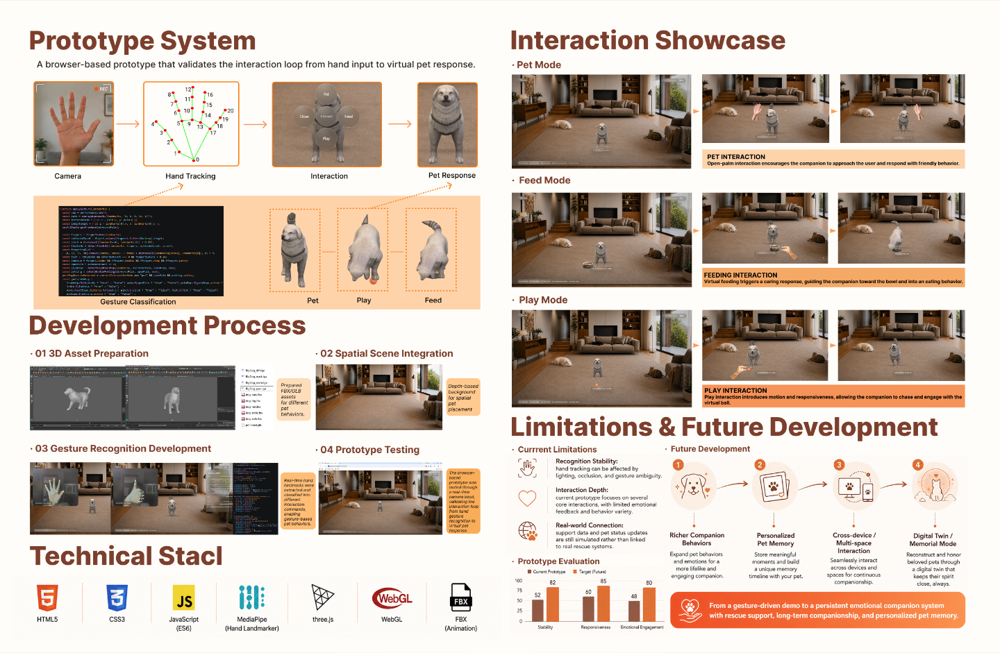
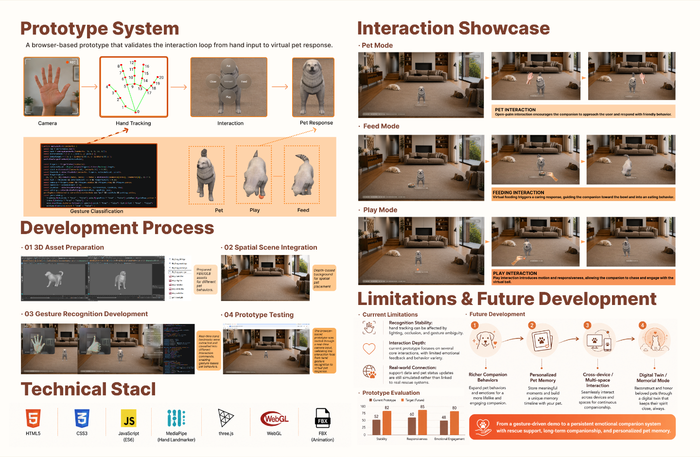
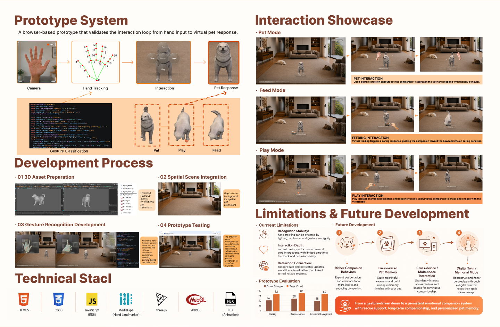
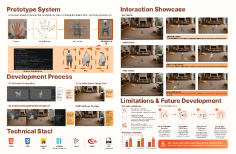

# Prototype System 技术链路悬停验证

实际入口为 `PortfolioImagePage` 的第 08 页，继续使用 `/assets/page08/8.png`。该图与参考素材逐像素一致，未替换或重绘整页。新增交互仅限左上 Prototype System 的三个透明触发区，坐标基于原图 4994 × 3257。

## 三组联动

- Hand Tracking：上方关键点图片边框、下方 Gesture Classification 代码截图边缘，以及两者之间原有斜向虚线箭头。
- Interaction：上方模式菜单图片边框，以及下方原 Pet、Play、Feed 行为标签的橙黄色底纹；没有新增连接线。
- Pet Response：上方结果图片边框、下方三张动作图的既有虚线框，以及通往 Pet Response 的原有虚线箭头。

使用单一活动组状态。鼠标或键盘焦点触发，离开恢复；约 200ms 过渡，不循环。装饰 SVG 不接收鼠标，透明触发区覆盖图片及标题；没有新增可见按钮、说明面板或页面留白。减少动态效果时取消过渡，触屏保留静态阅读。

## 实际浏览器截图

同一 1440px 显示尺寸，悬停前：



Hand Tracking 悬停后：



Interaction 悬停后：


Pet Response 悬停后：



390px 窄屏模拟鼠标悬停，几何位置仍与图片对应：



## 已执行

- `npm run build`：TypeScript 与 Vite 构建通过；`git diff --check` 通过。
- Chromium 的真实鼠标移动：1440、1024、768、390、320px 下分别检查三个入口；图片和标题均可触发。命中透明触发区，强调层达到最终可见状态。
- 五种宽度下逐组切换、快速连续切换及移开：活动组唯一，移开后所有强调完全淡出。
- 五种宽度下逐次 Tab 遍历：可见焦点与联动正确，失焦恢复。
- 模拟触屏点按不激活强调；模拟 `prefers-reduced-motion: reduce` 后过渡为 0s。
- 页面仍为原始比例，八张页面图片顺序不变；五种宽度下均无横向溢出，末尾 CTA 与图片之间没有新增间隙。
- 默认状态与隐藏整个交互层的截图逐像素相同。
- 三组悬停截图与默认截图对比：Camera 区域、右侧整栏和下方 Development Process / Technical Stack 区域均逐像素不变。
- MR Prototype 按钮保留，实际 href 仍为 `https://guardian-space-prototype.vercel.app`。没有新增摄像头请求，也未修改原型功能。
- 浏览器未报告 JavaScript 页面错误。

自动检查数值见 [check-results.json](check-results.json)。本次没有更改其他页面组件、原图或样式。

## 未执行

未实测用户电脑上的浏览器、真实手机、Safari、Firefox 或屏幕阅读器。窄屏按要求保留原整页同比例缩放，原图小字大小不变。

## 用户电脑预览

先保存本地修改，再在仓库目录执行：

```sh
git switch guardian-space-interaction-upgrade
git pull --ff-only origin guardian-space-interaction-upgrade
npm install
npm run dev
```

打开自己终端显示的地址，滚动至最后一页左上 Prototype System，依次悬停 Hand Tracking、Interaction、Pet Response 的图片或标题，也可用 Tab 聚焦。
