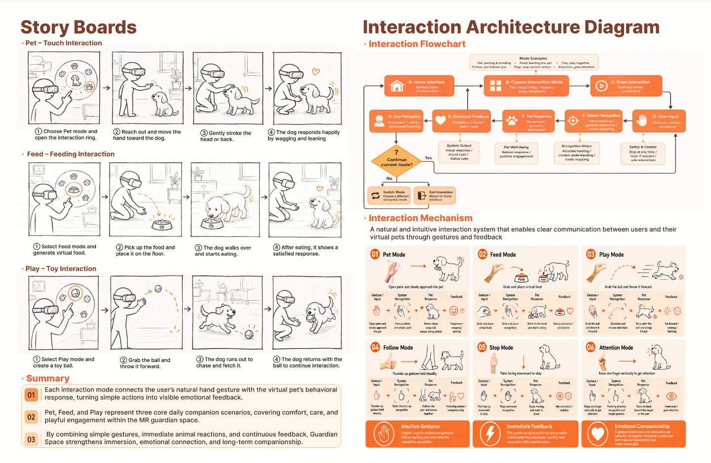
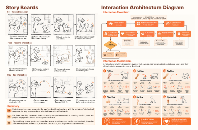

# 第 7 页 Story Boards 替换检查

实际渲染入口 `src/App.tsx` 中第 07 页的 `imageSrc` 已切换为 `/assets/storyboard-update/storyboard-page.png`，不是仅更新参考图。原素材保留，没有新增本页交互或动效。

`npm run build` 与 `git diff --check` 通过。Chromium 实际浏览器检查：

- 第七张图片实际请求新文件，原始尺寸 4994 × 3257。
- 显示 Story Boards，左侧 Pet、Feed、Play 三组四格故事板，右侧 Interaction Architecture Diagram。
- 1440px 下显示尺寸 1440 × 939.140625；390px 下为 390 × 254.34375，均符合原比例及整页宽度，无裁切、拉伸或横向溢出。
- 与上一页间隙为 0，仍有八张页面图片。第 6 页 User Flow 的图片引用和交互源码没有变化，浏览器中仍挂载十个流程触发区。
- 浏览器未出现 JavaScript 页面错误。

桌面实际截图：

窄屏实际截图：

数值记录见 [check-results.json](check-results.json)。未实测真实手机及其他浏览器。
