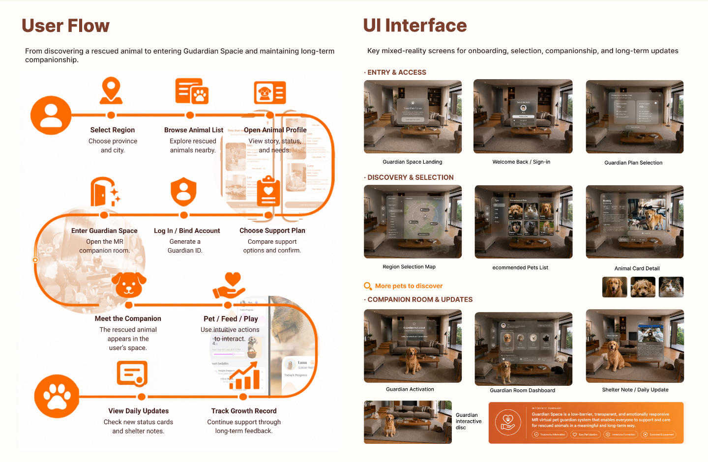
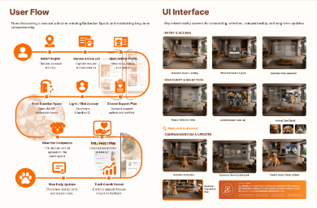

# User Flow / UI Interface 交互验证

实际入口为 `PortfolioImagePage` 第 06 页，继续使用 `/assets/page06/page06-ui-interface.png`；它与新增参考图内容逐像素一致。没有启用旧页面，没有更换整页图片。

## 实现

原图之上叠加 4994 × 3257 SVG 路径、节点/标题强调、右侧截图描边及十个透明触发区。行进约 9.2 秒，终点短暂强调约 0.42 秒；只出现移动光点及渐淡短尾，不补画永久路线、不隐藏原线。

路径按原图蛇形顺序前进：用户 → Select Region → Browse Animal List → Open Animal Profile → 右转向下 → Choose Support Plan → Log In / Bind Account → Enter Guardian Space → 左转向下 → Meet the Companion → Pet / Feed / Play → 右转向下 → Track Growth Record → View Daily Updates → 狗爪。Meet the Companion 前原图直线本来有一小段空隙，光点沿同一直线方向衔接，不穿越说明文字。

观察实际左侧流程图区，至少约 30% 进入视口后启动；等待整页图片解码，避免上方大图迟加载造成误触发。滚动离开或 `document.hidden` 时暂停，返回继续；同次挂载播放结束后不重播。任一步骤的鼠标悬停或键盘聚焦会终止自动播放，清除自动强调。减少动态效果或纯触屏设备跳过自动带路。

## 沿线关键帧（Chromium 实际截图）

约 2.4 秒后，第一个右侧转弯：


约 4.7 秒后，左侧转弯：



约 7.3 秒后，第二个右侧转弯：


约 8.5 秒后，最后一排从右向左，光尾位于光点右侧：


狗爪终点短暂强调，随后恢复静态：


截图包含实际截图调用与绘制延迟，因此以上时间为等待阈值，非逐帧时间码。

## 同区域悬停前后

未悬停：


悬停 Pet / Feed / Play：左侧图标环、标题底纹与右下 Guardian interactive disc 描边同时出现。


390px 宽度下的坐标检查（鼠标模拟悬停；真实触屏默认静态阅读）：



## 最终界面映射

| 左侧步骤 | 右侧界面 |
| --- | --- |
| Select Region | Region Selection Map |
| Browse Animal List | Recommended Pets List（原图截图下方标签缺少开头字母，未改动原图） |
| Open Animal Profile | Animal Card Detail |
| Choose Support Plan | Guardian Plan Selection |
| Log In / Bind Account | Welcome Back / Sign-in |
| Enter Guardian Space | Guardian Activation |
| Meet the Companion | 只强调左侧，无明确对应截图 |
| Pet / Feed / Play | Guardian interactive disc（截图中明确包含这些操作） |
| Track Growth Record | 只强调左侧，未关联普通仪表盘 |
| View Daily Updates | Shelter Note / Daily Update |

自动播放不触发右侧截图描边。

## 已执行检查

- `npm run build`：TypeScript / Vite 构建通过；`git diff --check` 通过。
- Chromium 真实页面播放：进入视口前不播放；离屏暂停、返回续播；十个节点依次触发，记录顺序为 0–9；完整经过三个转弯及最后一排向左；终点恢复静态；滚动返回不重播。
- 用户介入：真实鼠标悬停结束自动播放；键盘聚焦结束自动播放；移开或滚动返回不重播，自动强调无残留。
- 1440、1024、768、390、320px：十个步骤逐一真实悬停、快速切换、移开恢复，全部对应正确；八个有明确映射的步骤有且仅有一张截图联动，另外两个没有右侧描边。
- 上述五种宽度逐次 Tab 遍历十个步骤：焦点顺序、可见焦点与强调正确。
- 另在正常动态设置下逐一真实鼠标进入十个入口，验证命中目标、200ms 后最终强调可见以及移开后完全淡出；图层没有截获事件。
- 五种宽度下原图比例、下一页起点保持不变，没有横向溢出；图片总数仍为八张。
- 默认静态画面与隐藏叠加层截图逐像素相同，没有新增留白或控件；浏览器无 JavaScript 页面错误。
- 减少动态效果时无自动带路，节点交互仍可用；模拟纯触屏点按保持静态，不拦截滚动。
- `document.hidden` / `visibilitychange` 模拟：播放时间冻结，恢复后继续；结果见 [visibility-results.json](visibility-results.json)。其他自动检查见 [check-results.json](check-results.json)。

## 未执行与环境限制

无界面 Chromium 的真实标签切换不会将页面标记为后台，因此后台暂停使用可见性 API 模拟验证，未完成操作系统层面的真实后台标签测试。未实测用户 Windows 浏览器、真实手机、Safari、Firefox 或屏幕阅读器。窄屏保留原整页缩放，原图小字大小未改变。

## 在自己的电脑预览

在仓库目录保存好本地修改，然后执行：

```sh
git switch guardian-space-interaction-upgrade
git pull --ff-only origin guardian-space-interaction-upgrade
npm install
npm run dev
```

打开自己终端显示的本地地址。首次滚到 User Flow / UI Interface 后不要将鼠标放在步骤上，即可观看自动带路；刷新后可再次验证。悬停或 Tab 聚焦左侧步骤可以结束自动带路并探索对应界面。
